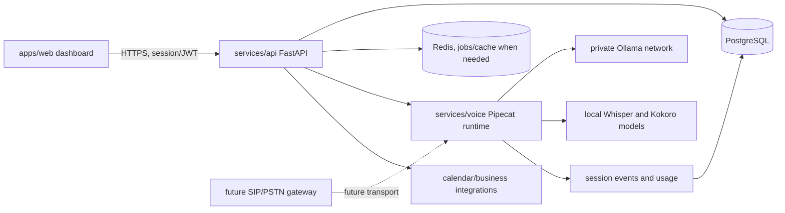

# Volvox platform architecture

## Current state and audit

The repository is a working Windows-first local prototype, not a hosted service. `bot.py` sends text to local Ollama through Pipecat 1.12.0; it can optionally synthesize with Kokoro, save WAV responses, and on Windows play them with `winsound`. `local_speech.py` provides WAV transcription, push-to-talk capture, and continuous microphone capture segmented by Pipecat Silero VAD. Conversation history is a bounded in-memory list local to a CLI run. `SETUP.md` records earlier smoke checks: local text, prerecorded Whisper/Ollama/Kokoro, and synthetic-WAV VAD passed there. Live microphone capture yielded near-silence; spoken live turns, barge-in, playback quality, and Linux deployment remain unverified.

### Findings

- `PipelineWorker` and `WorkerRunner` in `bot.py` are the current Pipecat API choice. `bot.py.bak` contains older `PipelineTask`/`PipelineRunner` usage and is not an active module. Keep Pipecat pinned until API migration is separately validated.
- Realtime means open-mic capture plus VAD turn segmentation, batch Whisper transcription, a complete LLM response, then optional WAV playback. It does not stream microphone audio to the model, stream playback to a client, or interrupt a response. During response processing the capture callback drops new audio.
- In `local_speech.py`, the realtime consumer uses `asyncio.to_thread` for queue reads, but Whisper inference and the Pipecat LLM/TTS worker run from the asyncio turn handler. They are sequential, not concurrent, but may block the microphone loop. Push-to-talk `input()` and WAV I/O are synchronous by design in the CLI.
- The microphone callback copies every block into a bounded queue; overflow drops a block and reports degradation. The ordinary recording callback accumulates an unbounded list until the user presses Enter. The input stream context closes normally, but VAD/model resources have no explicit application lifecycle or service shutdown.
- `WavWriter` closes on response-end and write errors, but a pipeline failure before response-end can leave its WAV handle open. Paths supplied to the CLI can overwrite arbitrary user-selected files; the CLI is trusted local use, not safe multi-tenant upload handling. WAV inputs are decoded in memory with no duration/size limit.
- Ollama defaults to loopback, which is appropriate for a local prototype. The new API must never expose the Ollama endpoint. Existing code has no credentials; the main security gap is that it has no identity, tenant, persistence, access control, audit trail, or network boundary.
- `winsound` makes playback Windows-specific. `sounddevice`/PortAudio needs Linux audio devices and is not suitable as a server-side call transport. Local model cache paths and packaging need deployment configuration. The current `requirements-speech.txt` has a Windows-motivated PyAV pin; do not treat it as a Linux lock.
- Existing `requirements*.txt` files are pip inputs, not fully resolved lock files. No API, ORM, migrations, dashboard, container, CI, or production test suite existed at audit time.

## Target architecture

`apps/web` is a Next.js App Router dashboard with server-side API proxy routes and Supabase password login. `services/api` owns JWT verification, tenant authorization, configuration, persistence, and control-plane endpoints. `services/voice` owns Pipecat and model execution; it is a Python module/package boundary, not a separate network service by default. `packages/shared` contains versioned JSON contracts, not language-specific runtime coupling. `infra` holds development/deployment assets. PostgreSQL is authoritative; Redis is for recoverable background jobs and ephemeral coordination, never the tenant boundary or sole copy of conversation data.

### Tenant and data rules

Every organization-owned row carries `organization_id`. API queries filter by the authenticated organization; write paths derive organization IDs from the authorized path and membership, never a body-supplied tenant ID. Composite foreign keys ensure an agent/session/event cannot reference a parent in another organization and ensure a membership's stored auth subject matches its user. PostgreSQL row-level security can be added as defense in depth when connection pooling and transaction-local tenant context are configured and tested. Roles are organization owner, admin, operator, and read-only viewer. Service credentials are scoped and rotated. Model endpoints bind to private interfaces and are firewalled from public ingress.

Sessions are distinct from immutable ordered events. Events store transcript/text and lifecycle metadata with explicit retention. Recording is off by default; adding it requires a documented consent UX, legal basis, encryption, access audit, retention/deletion policy, and storage controls. Usage events record model, duration/token/audio counters where available and idempotency keys; billing is a later subsystem. Integrations execute through allowlisted adapters with per-tenant credentials stored encrypted outside ordinary configuration rows.

### Reliability and operations

The API exposes liveness and `SELECT 1` readiness; structured logs include request ID and status/path, never auth headers, payloads, credentials, or full audio. Metrics cover request latency/errors, queue age, model failures, and usage. Shutdown stops accepting work, disposes SQLAlchemy connection pools, and closes model resources. Retries apply only to idempotent work. Database migrations are forward-only; rollback is a tested restore/forward-fix process, not destructive schema reversal. Backups are encrypted and restore-tested.

## Production gaps

The foundation now implements Supabase asymmetric JWT verification, database-provisioned identity and membership, tenant-scoped organization/agent CRUD, PostgreSQL schema migrations, health checks, and a Next.js dashboard. This local continuation validates API behavior using SQLite and isolated test databases; PostgreSQL migration/tenant integration has not been executed successfully on this Windows host. The dashboard lint/typecheck pass but Next child process restrictions blocked dev and build verification. Secrets management, TLS ingress, rate limiting, abuse controls, operational metrics, backup/restore, production deployment, and telephony remain incomplete. Realtime barge-in, echo control, transport selection, load characterization, Linux model/audio validation, session token refresh, Supabase user provisioning, and business-specific prompt/knowledge isolation also remain incomplete. This foundation is not production-ready.
